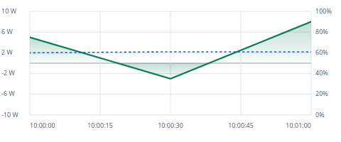
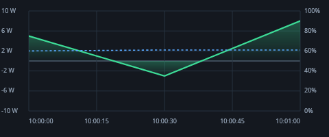

# WattLedger

**A local-first energy journal for Windows and Linux laptops.**

English · [简体中文](README.zh-CN.md)

WattLedger records battery power, energy use, charging and sleep gaps, and battery health in a local SQLite database. It combines a desktop dashboard with a scriptable CLI. Basic battery readings need no kernel driver or administrator rights; the application has no network service, accounts, cloud sync or telemetry.

The current source version is **0.2.1**. Check [Releases](https://github.com/dazi9/WattLedger/releases) and the [changelog](CHANGELOG.md) for published versions: features in this branch may be newer than a release asset. The application UI currently uses English; Simplified Chinese UI support is planned for the next iteration.


## What it does

- **Live readings:** battery discharge/charge watts, percentage, voltage, remaining energy and estimated time remaining; unavailable values stay unavailable.
- **Energy ledger:** active, AC, charging and sleep/standby sessions with durations, energy and battery changes; daily reports respect local midnight and daylight-saving boundaries.
- **Interactive charts on both desktops:** pan, zoom, original-point inspection, custom time ranges, energy/average-power/coverage statistics and follow-live views.
- **Light, Dark and System appearance:** persistent settings, shared colors and live theme updates where the desktop exposes them.
- **Battery health:** design/full-charge capacity, optional cycle count and stored health history.
- **Local history and exports:** SQLite, CSV samples, and JSON/Markdown reports.
- **Windows hardware context:** Energy Meter/RAPL package, CPU, GPU and DRAM readings where supported, plus optional brightness and foreground-process context.
- **Linux desktop integration:** sysfs battery readings, logind suspend/resume notifications, native Wayland or X11, optional tray and user-scoped start at login.

Per-app energy attribution, a multi-day desktop chart browser, standby alerts and a Chinese application UI are **not implemented yet**.

## Platform support and requirements

| Platform | Desktop and sensor path | Validation boundary |
|---|---|---|
| Windows x64 | WPF; battery IOCTLs and optional Energy Meter/RAPL | Windows CI builds/tests; primary hardware record is Windows 11 on a MECHREVO WUJIE. Recent tray, gesture and theme behavior still needs broader Windows hardware checks. |
| Linux x64 | Avalonia 12.1.4; sysfs and logind; native Wayland or X11 | Ubuntu 24.04 and Debian 12/13 CI builds/tests. Native Wayland startup and continued sampling checked on Ubuntu 24.04.5 GNOME with `DISPLAY` removed. Other desktop/driver combinations are not certified. |

Source builds require the [.NET 10 SDK](https://dotnet.microsoft.com/download/dotnet/10.0). Self-contained publish outputs include the .NET runtime, but Linux still requires native graphics, font and system libraries. The Debian package declares these dependencies; other distributions need equivalent packages. RPM/Arch packages and ARM64 builds are not provided by the current packaging workflow.

Native Wayland is **experimental upstream**. X11 remains a compatibility option, including through XWayland. A StatusNotifier/AppIndicator host is needed for a Linux tray icon; the app keeps its window available without one. Basic readings depend on readable battery interfaces and firmware, not just the OS version. See [hardware coverage](docs/supported-hardware.md) and [Linux backend requirements](docs/linux-display-backends.md).

## Get started

### Published builds

Use an available asset from [Releases](https://github.com/dazi9/WattLedger/releases), or build the current source below. Package artifacts are produced by the tag/manual package workflow; creating a commit or PR does not publish a release. The release workflow creates drafts for maintainers to publish manually.

For a downloaded Debian/Ubuntu package:

```sh
sudo apt install ./wattledger-linux-x64.deb
wattledger status
wattledger-desktop
```

The package installs the CLI, desktop launcher, application entry and icon. Linux portable/self-contained output can also be used directly after installing the required native libraries. A published Windows desktop executable starts the dashboard; add `--tray` to start in the notification area.

### Build and run from source

```sh
git clone https://github.com/dazi9/WattLedger.git
cd WattLedger
```

On Linux:

```sh
dotnet build WattLedger.Linux.slnx -c Release
dotnet run --project src/WattLedger.Cli -- status
dotnet run --project src/WattLedger.Linux
# Choose a backend explicitly if needed:
dotnet run --project src/WattLedger.Linux -- --backend=x11
```

On Windows, using PowerShell:

```powershell
dotnet build WattLedger.slnx -c Release
dotnet run --project src/WattLedger.Cli -- status
dotnet run --project src/WattLedger.App
dotnet run --project src/WattLedger.App -- --tray
```

The desktop records while running, including while hidden. `wattledger status` only reads live sensors: it does not create a database, write samples or take the sampler lease. Use the desktop or `watch` to accumulate history. Only one sampler may own a particular database; stop the other desktop/`watch` process if startup reports **NOT RECORDING**, then restart the intended sampler. Reports and sensor-only status remain usable alongside recording.

## CLI

The examples use the published `wattledger` executable. From source, replace it with `dotnet run --project src/WattLedger.Cli --`.

```sh
wattledger status
wattledger watch                         # Record until Ctrl+C
wattledger today
wattledger report --date 2026-10-27
wattledger export --format csv --output samples.csv
wattledger export --format json --date 2026-10-27 --output report.json
wattledger export --format md --date 2026-10-27 --output report.md
wattledger diag
wattledger init
wattledger --help
```

`report` and `export` default to today; `--date` uses a local calendar date in `yyyy-MM-dd` format. CSV contains samples; JSON and Markdown contain a day report. `init` creates/initializes a database. To choose a database, add `--db <path>` after the command, for example `wattledger watch --db ./workday.db`.

Sampling normally runs every **5 seconds on battery** and **30 seconds on AC**. The CLI is a system-level journal; a stored foreground-process name is context, not a per-app energy measurement.

## Desktop charts and appearance

Both desktops use shared chart calculations and interaction state. The chart covers **today's loaded samples**, initially following the latest 30 minutes. Short recordings use the available range; if all data already fits, zoom in to make panning meaningful.

| Action | Behavior |
|---|---|
| **Pan**, then ordinary left drag | Move through the recorded range; drag right for earlier samples. |
| **Earlier / Later** or Left / Right keys | Pan the visible window; boundary labels explain when no more data is available. |
| Horizontal scroll | Pan. Physical touchpad behavior remains under investigation; see the limitation below. |
| Vertical wheel, **+/−** buttons or keys | Zoom; wheel zoom is anchored to the pointer. |
| **Select**, then left drag | Pick original timestamps and calculate the selected interval. |
| Shift + left drag or middle drag | Temporarily pan, including in Select mode. |
| **Fit today**, double-click or Home | Fit the currently loaded day and pause following. |
| **Follow live** or End | Follow new samples again. A plain click does not pause following; dragging or navigation does. |
| **Fit selection / Clear selection**, Escape | Fit the selection or clear it. |
| From / To + **Calculate** | Enter `HH:mm` or `HH:mm:ss` within the same local day. Cross-midnight input is rejected. |

Hover shows the original sample timestamp, watts and battery percentage. **Positive watts mean discharge; negative watts mean charging**, including the live card and tray tooltip. The power axis adapts to the viewport; battery percentage stays at 0–100%.

Selection summaries show discharged/charged energy, signed net Wh, time-weighted average watts, min/max and valid-data coverage. They integrate **original power readings**, independent of display reduction. Missing rates, gaps over 60 seconds and recorded sleep gaps are excluded. A range with no usable power remains unavailable. These range estimates are separate from the capacity-calibrated session ledger, so totals can differ.

Choose **System / Light / Dark** in the footer's Theme selector. The choice persists across restarts. System mode follows the appearance supplied by the platform; choose Light or Dark explicitly if the desktop does not expose a theme preference.

The user has reported that Linux touchpad zoom does not work as expected. Pinch/precision-touchpad zoom and Windows gesture parity are **next-iteration work**; mouse-wheel handlers and automated input checks do not establish full touchpad support. Until then, use the zoom buttons or keyboard. See [chart behavior](docs/chart-navigation.md), [themes](docs/theme-modes.md) and [known issues](docs/KNOWN-ISSUES.md).

Light and dark chart previews, using the same synthetic data:




## Linux display backend

```sh
wattledger-desktop --backend=auto
wattledger-desktop --backend=wayland
wattledger-desktop --backend=x11
WATTLEDGER_BACKEND=x11 wattledger-desktop
```

The default is `auto`; a command-line option overrides the environment setting. Auto prefers a local Wayland session and permits X11 fallback when available. Explicit `wayland` requires a compositor and working EGL/OpenGL drivers and does not silently switch to X11. Explicit `x11` requires `DISPLAY`; on a Wayland desktop it needs XWayland. Backend selection applies at process startup; opening another instance activates the existing one.

Both desktops accept `--db <path>` and `--tray`. Start-at-login settings are user scoped; the Linux XDG entry preserves the selected backend and database path. Without a tray host, the Linux window remains available. For a headless machine use the CLI. See [backend selection and native libraries](docs/linux-display-backends.md).

## Data, backup and privacy

| Data | Windows | Linux |
|---|---|---|
| Default database | `%LocalAppData%\WattLedger\wattledger.db` | `$XDG_DATA_HOME/wattledger/wattledger.db`, or `~/.local/share/wattledger/wattledger.db` |
| Theme preference | `%LocalAppData%\WattLedger\preferences.json` | `$XDG_CONFIG_HOME/wattledger/preferences.json`, or `~/.config/wattledger/preferences.json` |

The CLI and desktop share the database on each platform. `--db` overrides its location; the desktop makes that path absolute for autostart. Quit an existing desktop instance before changing its database or backend. Data stays on your machine. Samples can contain battery/device details, optional Windows hardware context and foreground-process names; document contents, window titles and URLs are not collected.

Quit both the desktop and `watch` before copying or removing history. Back up the data directory, including any SQLite `-wal` / `-shm` files still present, or use SQLite's backup API for a live backup. Exports and explicit `--db` locations are separate files. Removing the package does not remove your history or preferences; disable start at login before uninstalling. Review diagnostics and exports before sharing them publicly.

See [privacy details](docs/PRIVACY.md). Network access used to download source/packages is separate from the installed application's local-only operation.

## How measurements work

```text
Windows battery IOCTL + optional Energy Meter/RAPL ─┐
Linux sysfs battery + logind events ────────────────┼─> sampler / session tracker
Windows power events ──────────────────────────────┘            │
                                                               ▼
                                                    SQLite (local WAL database)
                                                               │
                                          ┌────────────────────┴───────────────────┐
                                          ▼                                        ▼
                                  CLI reports/exports                    WPF / Avalonia desktops
```

Battery power is the system-level reference. Energy accounting integrates net power and uses remaining-capacity changes for calibration/fallback where available. Hardware counters cover only their exposed domains, not the entire laptop. A displayed remaining-time estimate is not a controlled battery-rundown measurement.

On Linux, missing/zero `power_now` can fall back to usable current and voltage; capacity changes can provide an estimate when no rate is usable. RAPL, brightness and foreground-process readings are currently unavailable on Linux. `Charging` is affirmative evidence of external power even if an AC/USB entry says `online=0`. Ambiguous `Full` / `Unknown` / `Not charging` without external-power evidence pauses session continuity rather than inventing battery activity.

Windows retains the `ModernStandby` gap label; Linux uses `SleepGap`. Both observed logind suspend and resume events are needed to mark a Linux suspend as confirmed; timestamp gaps alone are inferred. Sleep energy depends on usable capacity deltas, and missing energy is marked incomplete. Daily reports clip sessions at timezone-aware local midnights, including 23/25-hour daylight-saving days; clipped capacity/energy values can be prorated estimates. See [measurement methodology](docs/METHODOLOGY.md).

## Build self-contained packages

Linux x64:

```sh
dotnet publish src/WattLedger.Cli -c Release -r linux-x64 --self-contained true \
  -p:PublishSingleFile=true -p:IncludeNativeLibrariesForSelfExtract=true -o artifacts/cli-linux-x64
dotnet publish src/WattLedger.Linux -c Release -r linux-x64 --self-contained true \
  -p:PublishSingleFile=true -p:IncludeNativeLibrariesForSelfExtract=true -o artifacts/desktop-linux-x64
bash tools/package-linux.sh artifacts/cli-linux-x64 artifacts/desktop-linux-x64 artifacts/wattledger-linux-x64.deb
```

Windows x64, in PowerShell:

```powershell
dotnet publish src/WattLedger.Cli -c Release -r win-x64 --self-contained true `
  -p:PublishSingleFile=true -p:IncludeNativeLibrariesForSelfExtract=true -o artifacts/cli-win-x64
dotnet publish src/WattLedger.App -c Release -r win-x64 --self-contained true `
  -p:PublishSingleFile=true -p:IncludeNativeLibrariesForSelfExtract=true -o artifacts/desktop-win-x64
```

The Debian script needs `dpkg-deb` and Python 3, refuses to overwrite an existing output and currently produces an `amd64` package. Self-contained Linux builds still need the native libraries described above.

## Development and remaining work

```text
src/WattLedger.Core/       Native readers, sampling, energy/session engine, SQLite and reports
src/WattLedger.Desktop/    UI-free chart math/state, dashboard loading and theme preferences
src/WattLedger.App/        Windows WPF desktop
src/WattLedger.Linux/      Linux Avalonia desktop
src/WattLedger.Cli/        Command-line interface
tests/                    Engine, desktop-state and headless interaction tests
docs/                     Methodology, platform notes, privacy and follow-ups
```

Core has no UI dependency. Both desktop projects compile-link the shared presentation sources; platform controls translate events and draw the shared results. CI builds/tests Windows and Ubuntu/Debian targets and checks formatting. GUI automation, cross-compilation and CI containers do not replace physical hardware, suspend/resume, precision-touchpad or battery-rundown validation.

For synthetic demo data, quit any existing desktop instance, run `python tools/seed-demo.py --db demo.db`, then launch a desktop with `--db demo.db`. The script refuses the production name `wattledger.db` unless explicitly forced.

Next iteration: investigate Linux touchpad zoom and Windows gesture parity, and add a Simplified Chinese application UI. Later candidates include historical/multi-day desktop navigation, per-app **estimated** attribution, alerts, additional packaging/architectures and broader hardware validation; these are not promises tied to an already released version. See [the iteration plan](docs/NEXT-ITERATION.md), [known issues](docs/KNOWN-ISSUES.md), [changelog](CHANGELOG.md) and [contributing guide](CONTRIBUTING.md).

For reports, include the laptop/OS/desktop details and reviewed `wattledger diag` output. Keep personal database contents and serial numbers out of public attachments.

## License

MIT. See [LICENSE](LICENSE) and [third-party notices](THIRD_PARTY_NOTICES.md).
