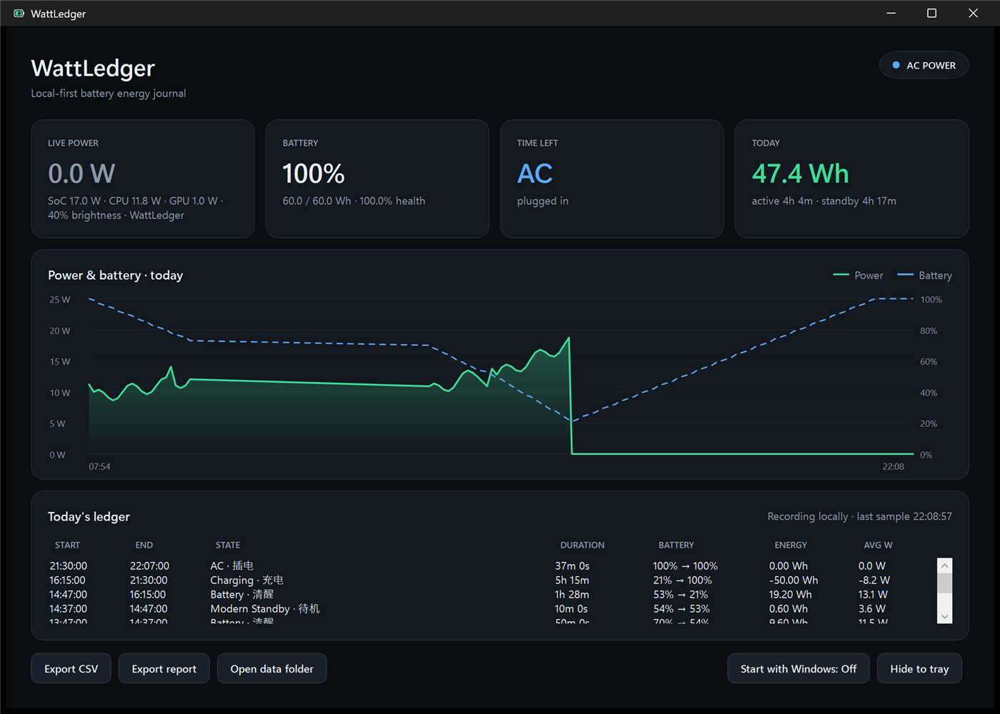

# WattLedger

**A local-first energy journal for Windows and Linux laptops.**

WattLedger records how much energy your battery actually delivers, separates active use from sleep, breaks system power down into CPU / GPU / DRAM / uncore where the hardware exposes it, and keeps a long-term battery-health history. No kernel driver, no administrator rights for basic battery readings, no network, no telemetry.



## Why another battery tool?

Windows shows a percentage. `powercfg /batteryreport` gives a static snapshot. HWiNFO and MSI Afterburner are excellent sensor dashboards, but they are not battery journals: they do not answer “where did today’s watt-hours go?” or “how much did standby drain overnight?”

WattLedger is deliberately narrow:

- **Live power**: battery discharge/charge watts, voltage, remaining energy, time left.
- **Energy accounting**: trapezoidal integration of battery power, calibrated against the battery’s remaining-capacity counter.
- **Session ledger**: AC, charging, battery, and Modern Standby segments with start/end percentage, duration, Wh, and average watts.
- **Hardware breakdown**: Windows `Energy Meter` (RAPL) counters for package, CPU, GPU, and DRAM power on supported Intel/AMD machines.
- **Battery health**: design capacity, full-charge capacity, cycle count, health trend.
- **Long-term history**: SQLite, local-only, exportable to CSV / JSON / Markdown.
- **Desktop app + CLI**: a WPF dashboard on Windows, an Avalonia desktop app on Linux, and a scriptable command-line interface.

### How it compares

| Tool | Live watts | Long-term journal | Standby accounting | Per-app energy | No driver/admin |
|---|---:|---:|---:|---:|---:|
| Windows Settings / battery report | partial | no | partial | newer builds | yes |
| HWiNFO64 | yes | CSV only | manual | no | partial |
| MSI Afterburner | GPU-centric | no | no | no | yes |
| Powir | no | battery report | no | no | yes |
| Watt’s Left | yes | 30 min | no | no | yes |
| **WattLedger** | **yes** | **yes** | **yes** | roadmap | **yes** |

## Requirements

- Windows 10 2004+ or Windows 11, x64; or Ubuntu 24.04 / Debian 12 or 13, x64, with GNOME.
- [.NET 10 SDK](https://dotnet.microsoft.com/) to build from source.
- A laptop battery with a supported Windows battery interface or Linux sysfs battery entries.
- Linux desktop requires XWayland in a GNOME Wayland session. The tray icon is optional and needs a GNOME AppIndicator extension; without a tray host, keep the app window open.
- Basic battery readings do not require administrator rights or a kernel driver. Linux sensor availability depends on readable kernel sysfs interfaces.

## Quick start

```powershell
git clone https://github.com/your-name/WattLedger.git
cd WattLedger

dotnet build WattLedger.slnx -c Release

# One-shot status
dotnet run --project src/WattLedger.Cli -- status

# Record continuously (Ctrl+C to stop)
dotnet run --project src/WattLedger.Cli -- watch

# Today's ledger
dotnet run --project src/WattLedger.Cli -- today

# JSON / Markdown / CSV export
dotnet run --project src/WattLedger.Cli -- export --format md --output report.md
dotnet run --project src/WattLedger.Cli -- export --format csv --output samples.csv

# Hardware / database diagnostics
dotnet run --project src/WattLedger.Cli -- diag

# Desktop app (tray + dashboard)
dotnet run --project src/WattLedger.App
```

On Linux, use the platform-specific solution and desktop project:

```sh
dotnet build WattLedger.Linux.slnx -c Release
dotnet run --project src/WattLedger.Cli -- status
dotnet run --project src/WattLedger.Linux
```

The Linux desktop supports `--db <path>` and `--tray`. By default it stores data under `$XDG_DATA_HOME/wattledger` (or `~/.local/share/wattledger`). For a self-contained x64 release:

```sh
dotnet publish src/WattLedger.Cli -c Release -r linux-x64 --self-contained true -p:PublishSingleFile=true -o artifacts/cli-linux-x64
dotnet publish src/WattLedger.Linux -c Release -r linux-x64 --self-contained true -p:PublishSingleFile=true -o artifacts/desktop-linux-x64
tools/package-linux.sh artifacts/cli-linux-x64 artifacts/desktop-linux-x64 artifacts/wattledger.deb
```

`wattledger status` is a sensor-only read: it does not create the database, record a sample, or take the sampler's writer lease, and remains usable while the desktop or `watch` records. Desktop `--db` paths are made absolute at launch so enabling start-at-login keeps the same database. The Linux chart spans the actual recorded timestamps (with a minimum range for short runs), with green signed power and a blue dashed battery-percentage curve; negative chart power indicates charging. Report/chart refresh is deferred while hidden to the tray and catches up when shown.

Linux battery values are read from kernel sysfs and converted from its micro-units to WattLedger's internal mWh, mW, and mV units. Missing sysfs values remain unavailable. A missing or zero `power_now` falls back to usable `current_now` and voltage. When a battery reports no usable rate, WattLedger estimates energy from capacity changes; quantization and firmware update cadence can make short intervals appear as zero. Linux currently does not provide RAPL, brightness, or foreground-process readings. A `SleepGap` is timestamp-detected; when logind suspend and resume events are both observed, its note records that confirmation, otherwise it remains explicitly inferred. Missing capacity is marked as unavailable and report summaries flag standby energy as partial. Basic live readings and UI startup were checked on one Ubuntu machine; real suspend/resume and controlled battery-rundown validation remain unperformed. See [the Linux design and validation record](docs/linux-port.md).

The Windows app and CLI share the same database:

```
%LocalAppData%\WattLedger\wattledger.db
```

On Linux, the default database is `$XDG_DATA_HOME/wattledger/wattledger.db`, falling back to `~/.local/share/wattledger/wattledger.db`. Both platforms accept `--db` for an explicit location.

Delete the file to reset history. Export before deleting if you want to keep it.

### Demo data for screenshots / UI work

The screenshot in this README is generated from synthetic data, not from a real user's history:

```powershell
python tools/seed-demo.py --db demo.db
dotnet run --project src/WattLedger.App -- --db demo.db
```

The script refuses to touch a database named `wattledger.db` unless you pass `--force`.

### Self-contained release

```powershell
dotnet publish src/WattLedger.Cli -c Release -r win-x64 --self-contained true `
  -p:PublishSingleFile=true -p:IncludeNativeLibrariesForSelfExtract=true -o artifacts/cli

dotnet publish src/WattLedger.App -c Release -r win-x64 --self-contained true `
  -p:PublishSingleFile=true -p:IncludeNativeLibrariesForSelfExtract=true -o artifacts/app
```

## How it works

```
Windows battery IOCTL ─┐
Energy Meter / RAPL ───┼─> Sampler (5 s battery / 30 s AC)
Power events ──────────┘        │
                                ▼
                       SessionTracker (AC / charging / battery / standby)
                                │
                                ▼
                         SQLite (WAL, local-only)
                                │
                    ┌───────────┴───────────┐
                    ▼                       ▼
              CLI reports              WPF dashboard
```

- **Battery**: SetupAPI enumeration plus `IOCTL_BATTERY_QUERY_STATUS` / `IOCTL_BATTERY_QUERY_INFORMATION` for mWh, mW, mV, design capacity, full-charge capacity, and cycle count.
- **System power**: the battery’s discharge rate is the ground truth. On Intel/AMD machines, the Windows `Energy Meter` performance counter set exposes package, core, graphics, and DRAM power without a driver.
- **Energy**: trapezoidal integration of net battery power over each sample interval, with a coulomb-counter fallback when firmware reports no rate.
- **Sleep gaps**: a sampling gap longer than 60 seconds remains `ModernStandby` on Windows for historical compatibility and is labeled `SleepGap` on Linux. A Linux session note records a confirmed suspend/resume only when both logind events were observed; otherwise the gap remains inferred. Gap energy uses remaining-capacity deltas when available; unavailable energy retains the existing numeric zero in the schema but is marked in the note and report as incomplete.
- **Storage**: SQLite in WAL mode, one row per sample, one row per session, one health snapshot per day.

See [docs/METHODOLOGY.md](docs/METHODOLOGY.md) for the formulas and limitations.

## Project layout

```
src/WattLedger.Core/     Native readers, energy engine, SQLite, reports
src/WattLedger.Cli/      Scriptable CLI (status / watch / today / export / diag)
src/WattLedger.App/      WPF tray app and dashboard
src/WattLedger.Linux/    Avalonia desktop app for Linux
tests/                   Unit tests for integration and session state
docs/                    Methodology, privacy, screenshot
```

The core library has no UI dependency; the CLI and platform desktop apps are thin clients over the same engine.

## Privacy

WattLedger is local-first by design:

- no network connections;
- no accounts or telemetry;
- no background cloud sync;
- the only data written is the SQLite database and local logs under `%LocalAppData%\WattLedger` on Windows or `$XDG_DATA_HOME/wattledger` on Linux.

See [docs/PRIVACY.md](docs/PRIVACY.md).

## Roadmap

- **v0.1** — system-level energy journal, tray app, CLI, CSV/JSON/Markdown export, battery health.
- **Linux port** — initial GNOME desktop and CLI support; local startup/instance smoke passed, while sensor coverage and hardware validation remain pending.
- **v0.2** — estimated per-app attribution (CPU/GPU time share), weekly reports, abnormal standby-drain alerts, import of Windows battery report and sleepstudy.
- **v0.3** — standardized battery rundown test mode, multi-battery support, ARM64, `winget` manifest, optional local read-only API.
- **v1.0** — stable database/export schema, installer, code signing, broader hardware validation.

## Limitations

- Battery firmware sampling is coarse: some machines update capacity in 1% steps and report rate noisily. WattLedger shows what the hardware exposes and labels estimates honestly.
- Some laptops expose no discharge rate; the coulomb-counter fallback is used.
- RAPL / `Energy Meter` availability varies by CPU and firmware. `wattledger diag` shows what your machine exposes.
- Per-app energy attribution is not part of v0.1. Windows does not provide a precise public per-app energy API; v0.2 will use CPU/GPU time-share estimates and label them as estimates.
- If the app is not running during a sleep period, that interval cannot be reconstructed. A Linux `SleepGap` is not proof that the machine slept. Keep the app running for continuous history; Linux supports user-scoped XDG autostart.
- Windows tested primarily on a MECHREVO WUJIE (Intel Core Ultra 5 226V, Windows 11 26200). Linux startup smoke passed locally, but no Linux laptop model is claimed tested; real hardware and suspend validation remain pending. See [docs/supported-hardware.md](docs/supported-hardware.md); community reports for other laptops are welcome.

## Contributing

Contributions are welcome. Please read [CONTRIBUTING.md](CONTRIBUTING.md). For bug reports, include the output of:

```powershell
dotnet run --project src/WattLedger.Cli -- diag
```

and your laptop model / Windows build. Do not attach personal files from the database unless you have reviewed them.

## License

MIT. See [LICENSE](LICENSE).

## 中文简介

WattLedger 是一个**本地优先的笔记本能量账本**：在 Windows 和 Linux 上记录电池与会话数据；Windows 提供 RAPL 分项和 Modern Standby，Linux 提供 sysfs 电池读数和推断的 SleepGap，并支持 CSV / JSON / Markdown 导出。

特点：

- 不装内核驱动、不需要管理员权限、不联网；
- 电池放电功率作为整机功耗基准，Windows Energy Meter（RAPL）做硬件分项；
- 用库仑计校准梯形积分，待机耗电单独计算；
- Windows 数据保存在 `%LocalAppData%\WattLedger\wattledger.db`；Linux 默认保存到 `$XDG_DATA_HOME/wattledger/wattledger.db` 或 `~/.local/share/wattledger/wattledger.db`。

```powershell
dotnet run --project src/WattLedger.Cli -- status
dotnet run --project src/WattLedger.Cli -- watch
dotnet run --project src/WattLedger.Cli -- today
dotnet run --project src/WattLedger.App
```

当前版本以系统级功耗和续航记录为主；按应用归因会在 v0.2 加入，并明确标注为估算。
