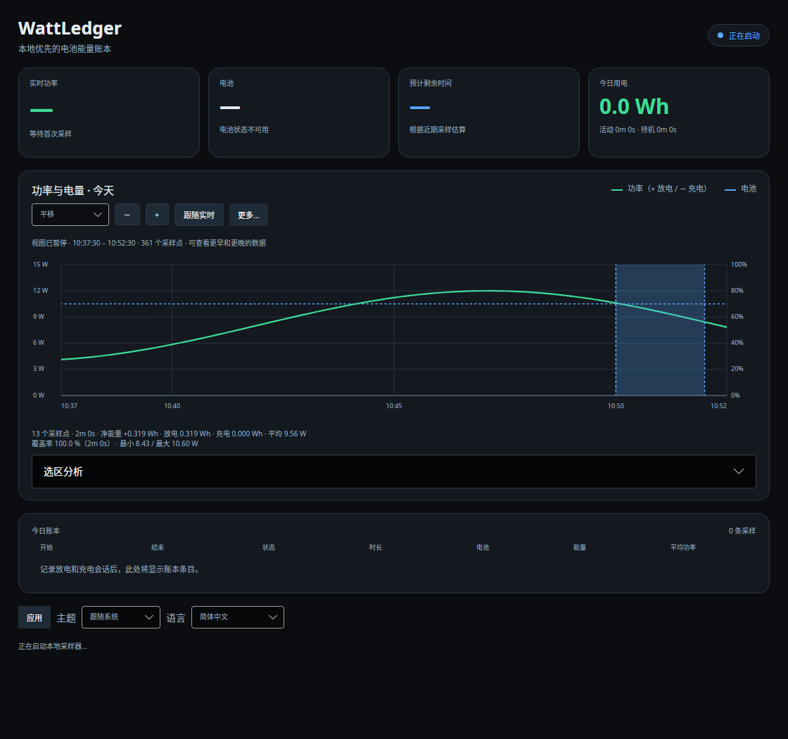

# Application language and compact interface

Both desktop applications support **System / English / 简体中文** in the footer. Changes apply immediately to labels, chart summaries, session rows, tray menus and application error context. System uses Simplified Chinese for `zh` locales and English otherwise; an untranslated template falls back to English. Operating-system exception details and native file pickers use the language supplied by the OS.

Language and theme share a preferences file:

| Platform | Path |
|---|---|
| Windows | `%LocalAppData%\WattLedger\preferences.json` |
| Linux | `$XDG_CONFIG_HOME/wattledger/preferences.json`, or `~/.config/wattledger/preferences.json` |

The `language` values are `System`, `English` and `SimplifiedChinese`. Saving preserves `theme` and unknown settings; an unreadable or invalid language falls back to System. Save failures keep the previous language and display an error. Language changes refresh the cached report without querying history again or resetting the chart viewport, selected timestamps or follow-live state.

This is desktop presentation only. Stored session types, CSV/JSON fields, CLI/report output, energy units and numeric culture stay stable. Manual input remains `HH:mm` or `HH:mm:ss` on the loaded local day. Existing theme settings continue to work independently.

## Fewer visible controls

The chart toolbar keeps a Pan/Select selector, zoom out/in, Follow live and **More**. The More menu contains Earlier/Later, Fit today, Fit selection and Clear selection. Dragging, scrolling, pinch where supported and keyboard shortcuts remain available.

**Selection analysis** expands the manual From/To inputs and Calculate button. Selection statistics stay visible without opening it. Navigation instructions and the distinction between power-integrated ranges and capacity-calibrated ledger totals remain available as help.

The footer's **Application** menu groups CSV/Markdown/JSON export, data folder, start at login, hide to tray and quit. Theme and language remain directly accessible.

## Focused validation

Resource checks parse every English/Chinese composite format and compare placeholder indices. Preference checks cover persistence and preservation of other settings. A headless desktop check switches language on a populated chart and verifies labels, selected timestamps, viewport and startup-failure status. The Linux preview uses synthetic data; WPF is cross-built here and still needs native visual/device confirmation.

