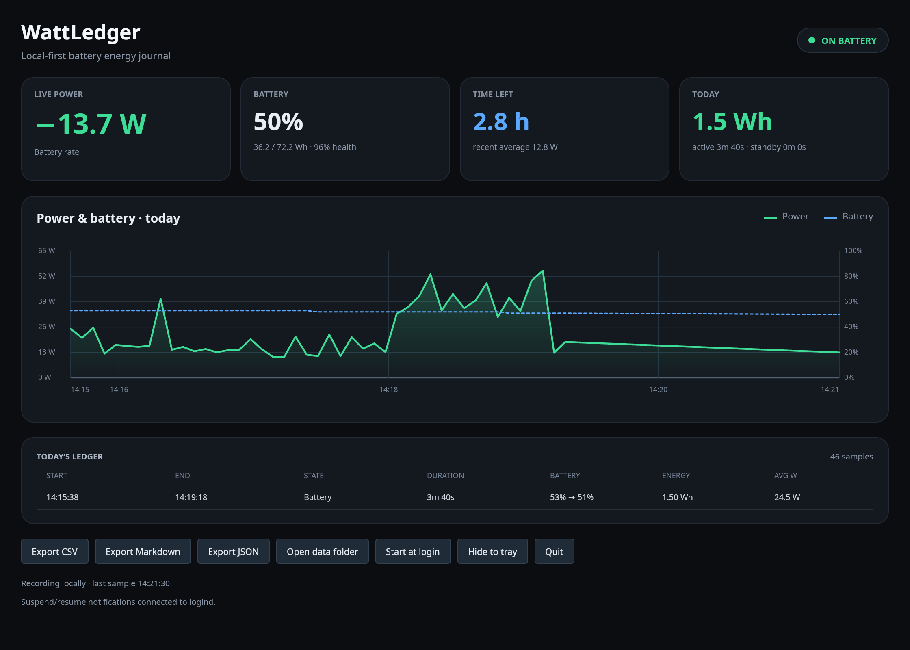

# Linux port: design and migration plan

This is the integration contract and status record for the initial Linux desktop port. It targets x64 GNOME on Ubuntu 24.04 and Debian 12/13. Automated tests, native desktop checks, and live sensor observations are separate from controlled hardware validation. No real suspend/resume cycle or controlled battery rundown has been validated. See the evidence record below for the machine, revision, and scope of each check.

## Design

- Keep the Windows solution and WPF application intact. `WattLedger.Linux.slnx` selects the shared Core, CLI, Linux desktop, and Core tests without pulling WPF into a Linux build.
- Keep sensor and operating-system integration in Core's platform implementation. The Linux desktop is an Avalonia client and accepts `--db <path>` and `--tray`.
- Read battery capacity and related values from readable sysfs battery entries. Linux exports energy in µWh, power in µW, and voltage in µV; Core converts them to internal mWh, mW, and mV. Missing or unreadable values remain unavailable. Charge-only devices may provide a percentage without energy capacity. When a usable discharge rate is unavailable, estimate from capacity deltas and label the result as an estimate. Battery quantization can hide small short-term changes.
- Keep Windows `ModernStandby` records and its threshold of more than 60 seconds unchanged. Linux uses `SleepGap` for any positive gap when logind suspend and resume events are both observed, including gaps of 60 seconds or less, and records that confirmation in the session note. Unconfirmed gaps require more than 60 seconds and are marked inferred. If the system bus is unavailable (including across a container/host boundary), use the inferred fallback. Neither logind nor the gap supplies battery measurements during the interval. When either endpoint lacks battery energy capacity, the existing schema stores numeric zero for the gap energy but marks the session note as `battery energy unavailable`; report summaries identify the standby-energy total as partial.
- Default Linux data lives in `$XDG_DATA_HOME/wattledger` or `~/.local/share/wattledger`; `--db` overrides the database path. Basic battery access should not need root.
- The GNOME desktop requires XWayland for an X11-backed Avalonia window in a Wayland session. Tray hosting is optional and depends on a GNOME AppIndicator extension. Without an available tray host, the app window must remain visible for continuous use. XDG autostart is user-scoped.
- CLI `status` reads sensors without acquiring the sampler lease or creating/writing the ledger; the desktop or `watch` may keep recording at the same time. Recording commands retain the exclusive writer lease.
- The Linux chart uses actual sample timestamps rather than midnight as its left edge, with a minimum range for single/short runs. Power and battery percentage have independent axes. Missing readings and long gaps break their respective curves. Hidden-to-tray windows retain sampling and lightweight tray status but defer report/chart/ledger work until shown; tray-host availability is signal-driven on a persistent session-bus connection.
- Explicit desktop `--db` paths are normalized at launch so an XDG autostart entry keeps the same database when the login working directory differs.
- Linux initially has no RAPL power breakdown, brightness reader, or foreground-process reader. Do not imply those Windows capabilities work on Linux.

## Build, release, and package

`WattLedger.slnx` remains the Windows solution and retains the WPF app. `WattLedger.Linux.slnx` is the Linux build/test boundary, including Core tests and headless Avalonia desktop tests. The CI workflow keeps a Windows full-solution build, Core tests, and Windows CLI/desktop publishes, and adds Linux-solution build/tests/publish on Ubuntu 24.04 and Debian 12/13 baselines. Debian runs in matching containers. Linux CI artifacts are self-contained `linux-x64` CLI and desktop publish directories; Debian packages can be built with:

```sh
tools/package-linux.sh <cli-publish-dir> <desktop-publish-dir> <output.deb>
```

The script reads the package version from `Directory.Build.props`, installs the CLI as `wattledger` and the desktop as `wattledger-desktop`, and does not require root. The `.deb` declares GTK 3, X11, fontconfig, ICU, OpenSSL, and XWayland runtime packages, including the package-name alternatives used by Ubuntu 24.04 and Debian 12/13. The optional GNOME AppIndicator extension is a desktop-environment choice and is not a hard package dependency.



This capture is from the actual local GNOME session, using an isolated temporary ledger populated by live samples during UI verification. It is not a controlled battery-rundown or suspend/resume result. The original Windows screenshot at [`docs/screenshot.png`](screenshot.png) is unchanged.

## Migration milestones and verification

| Milestone | Scope | Verification / status |
|---|---|---|
| 1. Shared engine | Core/CLI target `net10.0`; keep platform-specific readers separated | Original port's 29 Core tests passed locally and in the original CI run below. Follow-up regression results are recorded separately |
| 2. Linux desktop | Avalonia app, `--db`, optional `--tray`, logind pause/resume, XDG autostart | Original port's 8 desktop tests and local native startup/tray/activation checks passed. CI includes a native Xvfb/no-host startup check, not a GNOME or suspend test |
| 3. Release integration | Linux solution, Ubuntu/Debian CI, self-contained x64 artifacts, Debian package | Original CI passed all four jobs; the original package was extracted and installed for the current user on Ubuntu. Native Debian desktop/install checks remain unperformed |
| 4. Hardware validation | Battery sysfs units and permissions, suspend/resume accounting, GNOME/XWayland and tray behavior | Live battery values were observed on the local Ubuntu machine. No independent meter comparison, controlled rundown, or real suspend/resume validation was performed |

### Evidence record

- **Original port, revision `e56d69e5d14f16039409976be0763d4945f80741`:** [CI run 39561681760](https://github.com/dazi9/WattLedger/actions/runs/39561681760) passed Windows, Ubuntu 24.04, Debian 12, and Debian 13 jobs. Windows ran the Core suite and built/published WPF and CLI. Linux jobs ran Core/desktop tests and published both executables; Xvfb plus an isolated D-Bus session checked native startup, sample persistence, no-host `--tray` fallback, and a second launch. Debian jobs ran in containers, not real Debian GNOME sessions.
- **Local installation, 2026-10-22:** Ubuntu 24.04.5 LTS x64, GNOME/Wayland through XWayland, DMI product `XINGYAO Series`. The original CI `.deb` artifact was checksum-verified, extracted to a current-user installation (not installed with `dpkg`), and launched. CLI reported live sysfs battery values; an actual window and a StatusNotifier tray item were verified. This establishes basic operation on this one machine only, not measurement accuracy or full hardware certification.
- **Review follow-up, source revision `a87276eaa2f893aff8d4ad76713b4886708056e3`, 2026-10-22:** on the same Ubuntu machine, .NET SDK 10.0.402 built the Linux solution and cross-built the original Windows WPF solution with zero warnings/errors. All 33 Core and 24 Linux desktop test cases passed; the optional native second-launch test was also run with `WATTLEDGER_NATIVE_GUI_TESTS=1`. Tests cover status reads while a sampler owns the writer lease, no status-only ledger creation, zero `power_now` fallback, report labels, relative desktop paths, real SQLite-backed hidden/show refresh, chart layout and Skia icon pixels. Self-contained CLI/desktop binaries were published locally. The stricter Xvfb smoke check verified an actually viewable no-host `--tray` window, active-desktop CLI `status`, and second-launch behavior. A separate isolated D-Bus test with a fake watcher verified initial `--tray` hiding and automatic window restoration after watcher owner loss; this did not stop the real GNOME tray host. The native preview's X11 class was `wattledger` and its `_NET_WM_ICON` contained a 64×64 icon. The screenshot was visually checked against the Windows reference. These are functional checks, not measured power-consumption comparisons.
- **Follow-up remote CI:** results are revision-specific. [PR #2 checks](https://github.com/dazi9/WattLedger/pull/2/checks) identify the current revision and job outcomes; the original CI link above validates only `e56d69e`, not these fixes. The PR validation summary records the completed follow-up run separately.

### Explicitly not tested

Real logind suspend/resume delivery and energy accounting across a physical suspend, a controlled battery-rundown comparison, native Windows GUI interaction, native Debian GNOME GUI/package installation, and machines other than the one described above remain unvalidated. Fake sensor/logind fixtures exercise code paths but do not establish any of these hardware claims.

CI can establish that the selected projects compile, tests pass, and Linux publish outputs are produced on the configured OS baselines. Local native UI checks are separate from CI and do not establish that a particular laptop exposes expected sysfs values, that sleep events match every firmware behavior, or that tray extensions are installed. Record those only after hands-on validation.
